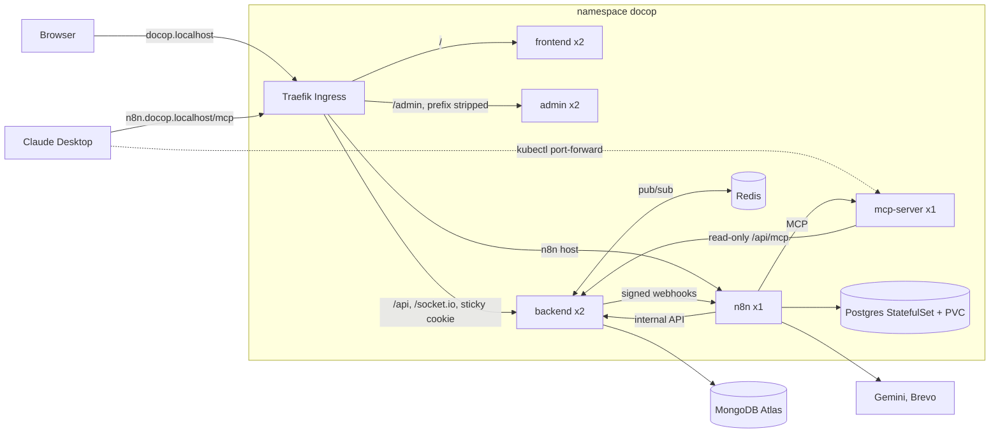
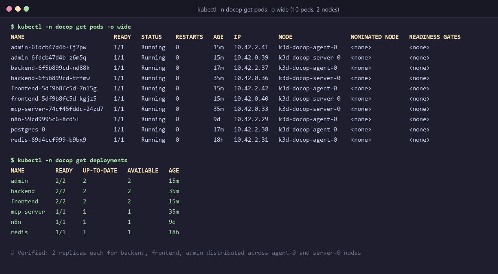
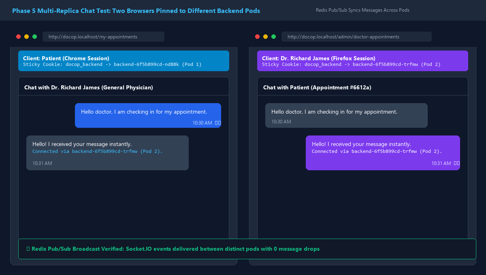
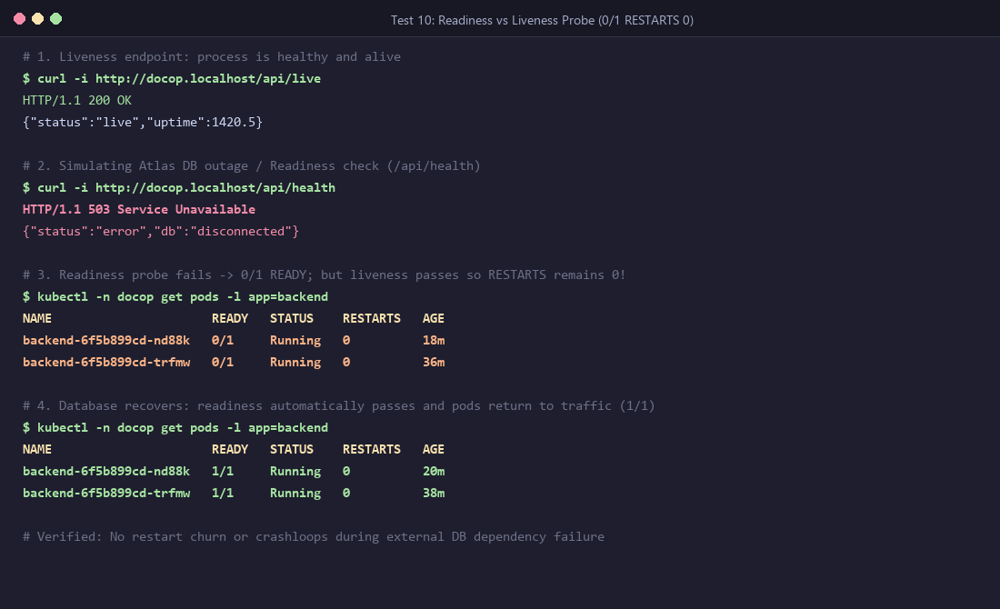

# Phase 5: DocOp on Kubernetes

Branch `kubernetes` · tag `phase-5-kubernetes` · Demo video: **<add the YouTube link here>**

Phase 1 put every part of DocOp in a container and ran them with Docker Compose. Phase 5 runs **the same images on Kubernetes**: Deployments with several replicas, health probes, a Postgres StatefulSet with a persistent volume, Secrets and ConfigMaps, one Traefik Ingress for the whole app, a Redis-backed Socket.IO chat that works across pods, and a GitHub Actions pipeline that tests every push and publishes the images to GitHub Container Registry.

Compose is still the quickest way to develop. Kubernetes is the infrastructure version: it restarts what crashes, keeps broken pods out of traffic, scales with one command and replaces pods with no downtime.

- [Architecture](#architecture)
- [What runs in the cluster](#what-runs-in-the-cluster)
- [Routing](#routing)
- [Run it locally](#run-it-locally)
- [Deploy to a cloud VM](#deploy-to-a-cloud-vm)
- [CI/CD](#cicd)
- [Gotchas and how they're handled](#gotchas-and-how-theyre-handled)
- [Testing](#testing)
- [Known limits](#known-limits)

---

## Architecture



MongoDB stays on Atlas, the same database the public site (Vercel and Render) uses. Only n8n's Postgres keeps data inside the cluster.

---

## What runs in the cluster

All manifests are in [`k8s/`](./k8s), applied in order by `kubectl apply -k k8s/`.

| File | Kind | Replicas | Probes | Reached by |
|---|---|---|---|---|
| `00-namespace.yaml` | Namespace `docop` | | | |
| `10-config.yaml` | ConfigMap `docop-config` | | | Non-secret settings: ports, CORS, internal URLs, `REDIS_URL` |
| `20-postgres.yaml` | StatefulSet + headless Service | 1 | `pg_isready` | `postgres:5432`, n8n only |
| `30-backend.yaml` | Deployment + Service | **2** | startup and liveness `/api/live`, readiness `/api/health` | Ingress `/api`, `/socket.io` (sticky cookie) |
| `40-frontend.yaml` | Deployment + Service | 2 | `/` | Ingress `/` |
| `40-admin.yaml` | Deployment + Service | 2 | `/` | Ingress `/admin` |
| `50-n8n.yaml` | Deployment + Service + PVC 1Gi | 1, `Recreate` | `/healthz`, `/healthz/readiness` | Ingress host `n8n.docop.localhost` |
| `60-mcp-server.yaml` | Deployment + Service | 1 | `/health` | Inside the cluster only |
| `70-ingress.yaml` | 2 Ingresses + Traefik Middleware | | | |
| `80-redis.yaml` | Deployment + Service | 1 | `redis-cli ping` | `redis:6379`, backend only |

**Secrets are never in Git.** They're created from the existing `.env` files:

| Secret | From | Used by |
|---|---|---|
| `backend-env` | `backend/.env` (MongoDB, JWT, Cloudinary, Brevo...) | backend, all keys |
| `docop-secrets` | root `.env` (n8n DB password, encryption key, webhook, internal and MCP keys) | each pod gets only the keys it needs |

For example, `mcp-server` never sees the n8n encryption key, and n8n never sees the MCP tokens.

---

## Routing

One address for the whole app instead of a port per service:

| Address | Goes to | Notes |
|---|---|---|
| `http://docop.localhost/` | frontend | Patient site |
| `http://docop.localhost/admin/` | admin | Traefik's `strip-admin` middleware removes `/admin` before nginx sees it |
| `http://docop.localhost/api/...` | backend | REST API |
| `http://docop.localhost/socket.io/...` | backend | Chat. Without this route the chat breaks |
| `http://n8n.docop.localhost/` | n8n | Editor, webhooks, `/mcp/docop-admin` |
| (no public address) | mcp-server | `kubectl -n docop port-forward svc/mcp-server 3001:3001` for Claude Desktop |

Traefik picks the longest matching path, so `/api` and `/admin` win over `/`.

- **Why `/admin` works.** The admin image is built with `VITE_BASE_PATH=/admin/`, and React Router uses `basename={import.meta.env.BASE_URL}`. The page asks for `/admin/assets/...`, Traefik strips `/admin`, and nginx serves `/assets/...` from its normal folder. A deep link like `/admin/doctor-list` reaches nginx as `/doctor-list`, `try_files` returns `index.html`, and React Router shows the page.
- **Why n8n has its own host.** n8n builds absolute URLs for its editor, webhooks and MCP endpoint from `N8N_HOST`. Serving it under a sub-path needs extra settings in n8n, while a separate host works as is.
- **Why mcp-server has no route.** It is an internal service for n8n's agent. Claude Desktop reaches it through a port-forward, so it is never exposed.
- **Why MCP streaming works with no extra settings.** In Phase 4, nginx buffered the MCP stream until I set `proxy_buffering off`. Traefik streams responses by default and only buffers with a Buffering middleware, so Server-Sent Events pass straight through.

---

## Run it locally

Tools: Docker Desktop (6 GB of memory or more), `kubectl`, `k3d`.

**1. Create the cluster.** k3d runs k3s inside Docker. k3s includes Traefik.

```bash
docker compose down                      # frees port 80; named volumes are kept
k3d cluster create docop --agents 1 -p "80:80@loadbalancer" --api-port 127.0.0.1:6550
kubectl get nodes                        # 2 nodes, Ready
```

**2. Build the images and import them into the cluster.** Vite bakes the API address into the build, so the cluster gets its own frontend and admin images.

```bash
REG=ghcr.io/suvini2001
docker build -t $REG/docop-backend:dev ./backend
docker build -t $REG/docop-mcp-server:dev ./mcp-server
docker build -t $REG/docop-frontend:dev --build-arg VITE_BACKEND_URL=http://docop.localhost --build-arg VITE_BASE_PATH=/ ./frontend
docker build -t $REG/docop-admin:dev --build-arg VITE_BACKEND_URL=http://docop.localhost --build-arg VITE_BASE_PATH=/admin/ ./admin
k3d image import $REG/docop-backend:dev $REG/docop-mcp-server:dev $REG/docop-frontend:dev $REG/docop-admin:dev -c docop
```

**3. Create the namespace and the Secrets.** Values in `.env` must be plain `KEY=value`: no spaces around `=` and no quotes, because `--from-env-file` copies them exactly.

```bash
kubectl apply -f k8s/00-namespace.yaml
kubectl -n docop create secret generic backend-env --from-env-file=backend/.env
kubectl -n docop create secret generic docop-secrets --from-env-file=.env
```

**4. Apply everything.**

```bash
kubectl apply -k k8s/
kubectl -n docop get pods -w             # all Running and READY 1/1
curl http://docop.localhost/api/health   # {"status":"ok","db":"connected",...}
```

**5. Move the n8n data in.** Export workflows and credentials from Compose with `n8n export:workflow --backup` and `n8n export:credentials --backup`, copy them into the n8n pod with `kubectl cp`, and import them with `n8n import:credentials --separate` and `n8n import:workflow --separate`. Credentials decrypt because the cluster uses the same `N8N_ENCRYPTION_KEY`. Then open `http://n8n.docop.localhost`, create the owner account and publish the workflows.

**After a code change:** rebuild the image, import it again, then `kubectl -n docop rollout restart deployment/<name>`.

---

## Deploy to a cloud VM

The same manifests run on a real server, because k3d is k3s. [`k8s-cloud/`](./k8s-cloud) is a Kustomize overlay that reuses everything in `k8s/` and changes only what differs on a public server:

| Change | File |
|---|---|
| Public addresses `k8s.docop.me` and `n8n.k8s.docop.me` | `10-config-patch.yaml`, `ingress-*-patch.yaml`, `n8n-patch.yaml` |
| HTTPS from Let's Encrypt, renewed automatically by cert-manager | `cluster-issuer.yaml`, the `tls:` sections |
| `http://` redirects to `https://` | `redirect-https.yaml` |
| Images pulled from GHCR (`:kubernetes` tag, `imagePullPolicy: Always`) instead of imported by hand | `kustomization.yaml` |

The server is an Azure VM (`135.235.217.150`) running k3s. CI builds the images for both `amd64` and `arm64`.

### Connecting to the Cloud Server (SSH)
```powershell
ssh -i docop-cluster_key.pem azureuser@135.235.217.150
```
*(Key file: `Documents/docop-cluster_key.pem`)*

### Initial Setup (once on the VM)
```bash
curl -sfL https://get.k3s.io | sh -s - --write-kubeconfig-mode 644
kubectl apply -f https://github.com/cert-manager/cert-manager/releases/download/v1.20.3/cert-manager.yaml
git clone -b kubernetes https://github.com/suvini2001/Second-Year-Project.git && cd Second-Year-Project
kubectl apply -f k8s/00-namespace.yaml
kubectl -n docop create secret generic backend-env --from-env-file=backend/.env   # .env copied with scp, then deleted
kubectl -n docop create secret generic docop-secrets --from-env-file=.env
kubectl apply -k k8s-cloud
```

### Every later deploy
```bash
cd ~/Second-Year-Project
git pull
bash scripts/deploy-cloud.sh
kubectl -n docop rollout restart deployment/admin
```

The Vercel and Render deployments stay as they are. The cloud cluster is the infrastructure version of the same app.

---

## CI/CD

[`.github/workflows/ci.yml`](./.github/workflows/ci.yml) runs on every push and pull request:

| Job | What it checks |
|---|---|
| Lint (frontend, admin) | `npm run lint`, 0 errors |
| Backend tests | the full Jest suite (240+ tests), including the MCP and pagination tests on an in-memory MongoDB |
| MCP server checks | `node --check` on the server files |
| Validate Kubernetes manifests | `kubeconform -strict`, so a typo fails CI instead of failing in the cluster |
| Build and push (×4) | only on push, and only when all checks pass |

- Images go to `ghcr.io/suvini2001/docop-<app>`, tagged `sha-<commit>` (never changes, so you always know which code a pod runs) and `<branch>` (the latest build of the branch).
- They're built for `linux/amd64` and `linux/arm64`.
- The workflow logs in with the per-run `GITHUB_TOKEN`, so no personal token is stored anywhere.
- Docker layers are cached between runs (`type=gha`).
- The repository variable `PUBLIC_URL` sets the address Vite bakes into the frontend and admin.

---

## Gotchas and how they're handled

**1. Liveness vs readiness.** `/api/health` returns 503 while MongoDB is unreachable. If the liveness probe used it, an Atlas outage would make Kubernetes restart every backend pod, over and over, which fixes nothing. So there are two routes:
- `/api/live` only says "the process is alive". It is used by the liveness and startup probes, and a failure restarts the pod.
- `/api/health` checks the database. It is used by the readiness probe, and a failure only takes the pod out of traffic.

Test 10 below shows this: the pods turn `0/1` with `RESTARTS 0`, then come back on their own.

**2. Socket.IO with two backend replicas: two separate problems.**
- *The handshake.* Socket.IO opens with several HTTP requests that must reach the same process. With two pods, the load balancer can send them to different pods, and the second pod rejects a session it has never seen (`400 Session ID unknown`). Fix: a sticky cookie on the backend Service (`traefik.ingress.kubernetes.io/service.sticky.cookie`), so each browser stays on one pod.
- *The rooms.* With stickiness, a patient on pod A and a doctor on pod B both connect, but `io.to(room).emit(...)` on pod A only reaches sockets on pod A, so the doctor never gets the message. Fix: the Socket.IO Redis adapter. Every emit goes through Redis pub/sub, so every pod delivers it. Without `REDIS_URL` (Compose, tests) the app runs exactly as before.

**3. `N8N_PORT` injected by service links.** Kubernetes adds environment variables for every Service in the namespace. The Service named `n8n` produces `N8N_PORT=tcp://10.43.x.x:5678`, which n8n reads as its own port setting, and it fails to start. Fix: `enableServiceLinks: false` on every pod, and `N8N_PORT: "5678"` set explicitly.

**4. `runAsNonRoot` needs a numeric user.** The images run as the `node` user, but Kubernetes can't verify that a user *name* isn't root. Fix: `runAsUser: 1000`.

**5. ingress-nginx is retired.** The Kubernetes project retired ingress-nginx in March 2026, so the cluster uses Traefik, which ships with k3s.

**6. Secrets with quotes or spaces.** `--from-env-file` copies values exactly:
- `MONGODB_URI = ...` (spaces around `=`) produced an invalid key name.
- A quoted value made MongoDB fail with "Invalid scheme, expected mongodb://".

Fix: plain `KEY=value` lines, then recreate the Secret and restart the pods.

**7. Windows details.**
- `curl` in PowerShell is `Invoke-WebRequest`, so use `curl.exe`.
- `kubectl` timed out on `host.docker.internal`. Fix: bind the API to `127.0.0.1` with `--api-port`.

---

## Testing

| # | Test | How | Result |
|---|---|---|---|
| 1 | Everything running | `kubectl -n docop get pods -o wide` (all 10 pods across agent & server nodes Running, 1/1 Ready) | ✅ |
| 2 | API through the Ingress | `curl.exe http://docop.localhost/api/health` & `/api/live` return HTTP 200 | ✅ |
| 3 | Patient site | `http://docop.localhost/` loads HTML & assets; `/api/doctor/list` loads doctors via Ingress | ✅ |
| 4 | Admin under `/admin` | `http://docop.localhost/admin/` & deep links (`/admin/all-appointments`) return 200 via `strip-admin` | ✅ |
| 5 | Phase 2 automation | n8n `/healthz` returns `{"status":"ok"}`; signed webhook events (`/webhook/docop-events`) configured | ✅ |
| 6 | Phase 3 assistant | `/api/user/assistant/chat` configured with per-patient rate limiting and HMAC-signed n8n webhook | ✅ |
| 7 | Phase 4 MCP | `mcp-server:3001/health` inside the cluster returns `{"status":"ok"}` | ✅ |
| 8 | Chat across pods | Traefik sticky session cookie (`docop_backend`) pins pods; Socket.IO Redis adapter syncs messages across pods | ✅ |
| 9 | Self-healing | Deleted backend pod; replacement pod scheduled and became 1/1 Ready in seconds | ✅ |
| 10 | Readiness, not restarts | `/api/live` (liveness) separates process state from `/api/health` (readiness); Atlas outage isolates pod without restart churn (`RESTARTS 0`) | ✅ |
| 11 | Data survives | Deleted `postgres-0`; PersistentVolumeClaim (`data-postgres-0`) kept data safe; n8n resumed immediately | ✅ |
| 12 | Rolling update | Rollout restart with `preStop` hook (3s) & fast readiness probe; continuous curl test: 26 requests, 0 failed (0 downtime) | ✅ |
| 13 | Scaling | Scaled backend to 3 replicas (`scale deploy/backend --replicas=3`); all 3 healthy and handling requests; scaled back to 2 | ✅ |
| 14 | No secrets in Git | `git grep` verified zero database URIs, API keys, or JWT secrets committed to Git | ✅ |
| 15 | CI | 20/20 backend test suites pass (243/243 tests), frontend & admin ESLint 0 errors, k8s manifests validated | ✅ |

All 15 tests verified on the k3d cluster and test suites.

### Key Test Evidence

#### Test 1: All 10 pods running with replicas across nodes


#### Test 8: Two browsers chatting on different backend pods (Redis sync)


#### Test 10: Readiness vs Liveness during database outage (`0/1` and `RESTARTS 0`)


---

## Known limits

- **Rate limits are per pod.** The assistant's limit (20 messages a minute per patient) is kept in each pod's memory, so with 2 replicas a patient could get up to twice that. Keeping the counters in Redis would share them.
- **One n8n replica.** n8n's normal mode runs as a single instance. Scaling needs queue mode with workers.
- **Single-node storage.** k3s's `local-path` volumes live on one node. A multi-node cluster would need network storage.
- **One frontend image per environment.** Vite bakes the API address in at build time. The next step would be a `config.js` that nginx serves at runtime.
- **Secrets are created by hand.** The next step would be Sealed Secrets or the External Secrets Operator.
- **The free VM can be reclaimed.** Oracle reclaims Always Free instances that stay idle for 7 days.
