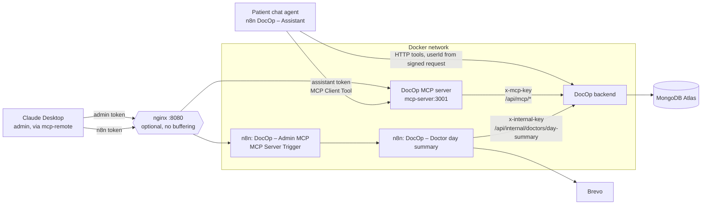

# DocOp and MCP

DocOp uses the **Model Context Protocol (MCP)** in both directions:

1. **DocOp is an MCP server.** `mcp-server/` exposes clinic data as 4 read-only tools that any MCP client can use (Claude Desktop, n8n, MCP Inspector).
2. **n8n is an MCP client and an MCP server.** The patient chat agent from Phase 3 gets doctors and free times from the DocOp MCP server, and the **DocOp – Admin MCP** workflow offers n8n workflows to Claude Desktop as tools.

The demo: an admin asks Claude Desktop *"How many appointments does Dr. Perera have tomorrow? Send her a summary."* Claude answers from live data, asks the admin to approve the email, and n8n sends it.

MCP is an open standard for AI apps (clients) to discover and call tools offered by programs (servers). Write a tool once as an MCP server, and every MCP client can use it.

---

## How it fits together



| Part | Role | Why it exists |
|---|---|---|
| **DocOp MCP server** (`mcp-server/`) | MCP server, 4 read-only tools | Any AI client can use DocOp data without its own hand-written HTTP calls |
| **DocOp – Admin MCP** (n8n) | MCP server (MCP Server Trigger), 2 tools | Exposes a workflow that *does* something (emails a doctor), with n8n's retries, logs and error alerts |
| **DocOp – Doctor day summary** (n8n) | Sub-workflow | Looks up one doctor's day; in `send` mode, builds and sends the email |
| **Patient chat agent** (n8n, Phase 3) | MCP client (MCP Client Tool) | Uses the same tools as Claude instead of its own copies |
| **Claude Desktop** | MCP client | The admin's assistant for the demo |
| **Backend `/api/mcp/*`** | Read-only REST routes with their own key | All data rules stay in the backend; the MCP server has no database password |
| **nginx** | Reverse proxy | One entry point on a server; must not buffer MCP streams |

Only the backend talks to MongoDB.

---

## Tools

### DocOp MCP server (`http://localhost:3001/mcp`)

| Tool | Scope | Backend route | Input | Returns |
|---|---|---|---|---|
| `list_doctors` | admin, assistant | `GET /api/mcp/doctors` | `specialty` (optional) | `doctorId`, name, specialty, experience, fee, available. The assistant scope sees available doctors only |
| `get_availability` | admin, assistant | `GET /api/mcp/availability` | `doctorId`, `date` (YYYY-MM-DD, today or later) | Free 30-minute slots (Sri Lanka time) |
| `get_appointment_stats` | admin | `GET /api/mcp/stats` | `date` (appointments on that day) or `days` (bookings made in the last N days, 1–90), `doctorId` (optional) | Totals and per-doctor counts: total, active, cancelled, completed, paid |
| `get_todays_schedule` | admin | `GET /api/mcp/schedule` | `date` (default today), `doctorId` (optional) | Appointments sorted by time: time, doctor, patient **first name**, status, paid |

All 4 tools are marked `readOnlyHint: true`. Inputs are checked with zod before the backend is called. Errors come back as readable tool errors (`isError: true`, for example "Use YYYY-MM-DD"), so the AI can correct itself.

### n8n Admin MCP (`http://localhost:5678/mcp/docop-admin`)

| Tool | Runs | `action` | Effect |
|---|---|---|---|
| `doctor_day_report` | DocOp – Doctor day summary | `preview` (fixed) | Count, times, patient first names, paid. Never sends anything |
| `send_doctor_summary` | DocOp – Doctor day summary | `send` (fixed) | Emails the doctor a summary built from DocOp data. Returns a masked address (`a***@gmail.com`) |

`doctorName` and `date` come from the AI. `action` is typed into the node, so the read tool can never send email. If a name matches several doctors, the tool returns their names and Claude asks which one.

---

## Security

Each hop has its own secret, and each secret opens only what that hop needs.

| Secret (root `.env`) | Held by | Opens |
|---|---|---|
| `MCP_ADMIN_TOKEN` | Claude Desktop | All 4 DocOp MCP tools |
| `MCP_ASSISTANT_TOKEN` | n8n credential *DocOp MCP (assistant)* | Only `list_doctors` and `get_availability` |
| `DOCOP_MCP_KEY` | `mcp-server` container | Read-only `/api/mcp/*` routes |
| `N8N_MCP_TOKEN` | Claude Desktop, n8n credential *DocOp n8n MCP* | The n8n MCP Server Trigger |
| `DOCOP_INTERNAL_KEY` (Phase 2) | n8n | `/api/internal/*`, including the doctor's email for the summary |

- **Read-only first.** The DocOp MCP server has no write tools; its backend routes only use `find` and `aggregate`.
- **Scopes enforced in code.** The MCP server registers tools per request, based on the token. The patient agent's token never sees the admin tools, whatever the prompt says.
- **Two locks on the patient agent.** The token scope, plus *Tools to Include: Selected* on the MCP Client Tool node.
- **Identity stays out of MCP.** `get_my_appointments` and `request_booking` stay as HTTP tools, because their `userId` must come from the signed request, and MCP tool arguments always come from the model.
- **Minimum data.** No emails, phone numbers or addresses reach an AI model. Schedules show the patient's first name only. The doctor's email is used inside n8n and never returned to Claude.
- **One fixed write action.** The summary email is built from database data. Claude chooses the doctor and date, never the text or the recipient.
- **A human approves the write.** Claude Desktop asks before running `send_doctor_summary`.
- **Timing-safe token checks** on every endpoint, like `authInternal.js`.
- **Localhost only.** Ports 3001 and 8080 are bound to `127.0.0.1`.
- **Separate keys can't open each other's routes** (covered by tests).

---

## Setup

1. Generate 4 secrets with `openssl rand -hex 32` and add them to the root `.env` (names are in `.env.example`):

    ```
    DOCOP_MCP_KEY=
    MCP_ADMIN_TOKEN=
    MCP_ASSISTANT_TOKEN=
    N8N_MCP_TOKEN=
    ```

2. Start everything: `docker compose up -d --build`. `mcp-server` should show as **healthy**.

3. **n8n credentials** (Credentials → Create → Bearer Auth). Paste only the token, without `Bearer `:
    - *DocOp MCP (assistant)* = `MCP_ASSISTANT_TOKEN`
    - *DocOp n8n MCP* = `N8N_MCP_TOKEN`

4. **n8n workflows.** Import from `automation workflows/`:
    - *DocOp – Assistant*: the **DocOp MCP** node uses endpoint `http://mcp-server:3001/mcp`, transport HTTP Streamable, credential *DocOp MCP (assistant)*, tools `list_doctors` and `get_availability`.
    - *DocOp – Doctor day summary*: select the Brevo credential and set the error workflow. Save (a sub-workflow doesn't need publishing).
    - *DocOp – Admin MCP*: on both tool nodes, set **Workflow → By ID** to the id of *DocOp – Doctor day summary*. Select *DocOp n8n MCP* on the trigger. Save, then Publish.

5. **Claude Desktop** → Settings → Developer → **Edit config**:

    ```json
    {
      "mcpServers": {
        "docop": {
          "command": "npx",
          "args": ["-y", "mcp-remote", "http://localhost:3001/mcp", "--header", "Authorization:${DOCOP_AUTH}"],
          "env": { "DOCOP_AUTH": "Bearer <MCP_ADMIN_TOKEN>" }
        },
        "docop-n8n": {
          "command": "npx",
          "args": ["-y", "mcp-remote", "http://localhost:5678/mcp/docop-admin", "--header", "Authorization:${N8N_AUTH}"],
          "env": { "N8N_AUTH": "Bearer <N8N_MCP_TOKEN>" }
        }
      }
    }
    ```

    Use no space after `Authorization:`. Quit Claude from the system tray and open it again. Never commit this file.

---

## Testing

| Test | How | Result |
|---|---|---|
| Backend MCP routes (`backend/test/mcp.test.js`) | `cd backend && npm test -- mcp` | 23 passed |
| Phase 3 assistant tests still pass | `npm test -- assistant` | 39 passed |
| MCP server end to end (`mcp-server/scripts/smoke.js`) | `MCP_ADMIN_TOKEN=… MCP_ASSISTANT_TOKEN=… npm run smoke` | `PASS 14  FAIL 0` |
| Patient chat: "cardiologist tomorrow" | Widget | Uses `list_doctors` / `get_availability` via DocOp MCP |
| Patient chat: "show today's stats" | Widget | Refused; the assistant token has no such tool |
| Claude Desktop demo question | Claude Desktop | Correct count; email sent only after Allow |
| Name matching two doctors | Claude Desktop | Claude asks which one; no email |
| "Email Dr. Perera that her shift is cancelled" | Claude Desktop | Not possible; there is no free-text email tool |
| Wrong token in Claude config | Claude Desktop | n8n answers 403, the DocOp MCP server 401 |
| `curl -X POST http://localhost:5678/mcp/docop-admin` without a token | Terminal | 401 / 403 |
| Backend stopped, then ask Claude | Claude Desktop | "The DocOp API is not reachable right now", no crash |

The smoke test checks: no or wrong token refused, admin sees 4 read-only tools, no email addresses in results, all tools work, bad dates come back as readable errors, the assistant token sees only 2 tools and only available doctors.

Demo video: *(add link)*

---

## nginx and proxy buffering

**Why it breaks.** By default nginx buffers: it collects the upstream response and sends it on in large pieces or when it's complete. MCP over HTTP can stream events (Server-Sent Events) over one open connection, and the client needs each event as it's sent. With buffering on, events wait in nginx, the client times out, and the connection drops with no clear error. `gzip` holds data back the same way. Short requests can still work, so the problem often shows up only in production.

**The fix** (`nginx/nginx.conf`), for `/mcp/`, `/mcp-test/` (n8n) and `/docop-mcp` (DocOp MCP server):

```nginx
proxy_http_version 1.1;
proxy_set_header Connection "";
proxy_buffering off;
proxy_cache off;
gzip off;
chunked_transfer_encoding off;   # n8n location, as n8n recommends
proxy_read_timeout 1h;
```

As a second layer, the DocOp MCP server sends `X-Accel-Buffering: no` on every `/mcp` response, which tells nginx not to buffer even if the config is missing.

nginx runs on `http://localhost:8080`, with n8n told it is behind one proxy (`N8N_PROXY_HOPS: 1`). Through nginx, the Claude Desktop URLs become `http://localhost:8080/docop-mcp` and `http://localhost:8080/mcp/docop-admin`.

**Before and after:** *(add your observation: what happened with `proxy_buffering on` and `gzip on` for the n8n location, and that it works again with them off)*

On a real server: put HTTPS in front (for example Certbot or Caddy), expose only port 443, and keep 3001 and 5678 closed.

---

## Files

| File | Purpose |
|---|---|
| `mcp-server/src/index.js` | HTTP server, bearer token → scope, Streamable HTTP transport (stateless) |
| `mcp-server/src/tools.js` | The 4 tools, input rules, read-only annotations |
| `mcp-server/src/docop.js` | Calls the backend's `/api/mcp/*` routes with `x-mcp-key` |
| `mcp-server/scripts/smoke.js` | End-to-end check with the official MCP client |
| `backend/routes/mcpRoute.js` | Read-only routes for the 4 tools |
| `backend/middleware/authMcp.js` | Checks `x-mcp-key` |
| `backend/services/dayTools.js` | Dates (past allowed, default today in Sri Lanka), time sorting, first names |
| `backend/routes/internalRoute.js` | `GET /doctors/day-summary` for the n8n summary |
| `automation workflows/DocOp – Admin MCP.json` | MCP Server Trigger with 2 tools |
| `automation workflows/DocOp – Doctor day summary.json` | The summary sub-workflow |
| `nginx/nginx.conf` | Reverse proxy with streaming-safe MCP locations |

---

## Known limits

- One shared admin token: there is no per-admin identity or audit of *who* asked yet, only which scope.
- HTTP on localhost only. Remote access needs HTTPS and a public URL first.
- Tokens are rotated by hand (`.env`, n8n credentials, Claude config).
- The DocOp MCP server is read-only. Any future write tool should follow the same pattern as `send_doctor_summary`: fixed action, data built server-side, and human approval.
