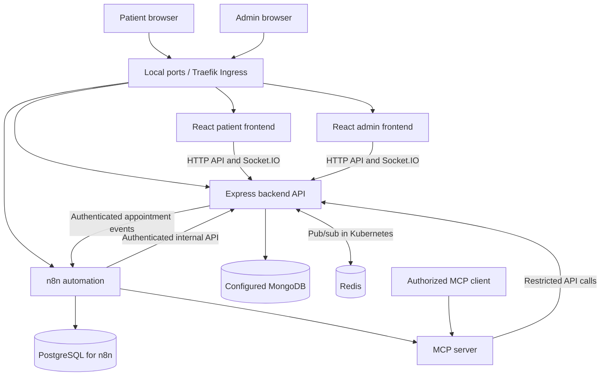

# DocOp — Medical Appointment Platform

DocOp is a full-stack medical appointment platform with separate patient and administration web applications, an Express API, real-time messaging, n8n workflow automation, and a restricted Model Context Protocol (MCP) server.

> This guide describes the configuration present in the `kubernetes` branch. Credentials, external services, DNS, certificates, and cluster prerequisites must be configured separately.

## Components

| Component | Responsibility | Local Compose access |
|---|---|---|
| `frontend/` | Patient-facing React application | http://localhost:5173 |
| `admin/` | React administration application | http://localhost:5174 |
| `backend/` | Express API, business logic, authentication, MongoDB access and Socket.IO | http://localhost:8000 |
| n8n | Event-driven and scheduled automation | http://localhost:5678 |
| PostgreSQL | n8n's database | Internal port 5432 |
| Redis | Socket.IO pub/sub in Kubernetes | Internal port 6379 |
| `mcp-server/` | Restricted MCP tools backed by the DocOp API | Port 3001; local-only in Compose |
| MongoDB | Application database configured for the backend | Configured externally |

## Architecture

The Kubernetes base manifests deploy PostgreSQL for n8n, but do **not** deploy MongoDB. The backend connects to the MongoDB instance configured in its environment.



### Main data flow

1. Patients and administrators use separate React applications.
2. HTTP API requests and real-time chat connections go to the Express backend.
3. The backend owns application logic and accesses MongoDB.
4. Authenticated appointment events can be forwarded to n8n.
5. n8n runs event-driven and scheduled workflows and stores workflow state in PostgreSQL.
6. The MCP server exposes a limited tool interface and calls the backend; it is not a direct database interface.
7. Redis supports cross-instance Socket.IO messaging in Kubernetes; it is not the primary application database.

## Technology stack

- **Patient frontend:** React 19, Vite, React Router, Axios, Socket.IO client and Tailwind CSS.
- **Admin frontend:** React 19, Vite, React Router, Axios and Socket.IO client.
- **Backend:** Node.js ES modules, Express 5, Mongoose, JWT, bcrypt, Socket.IO, Redis client/adapter, Cloudinary, Brevo SDK and Stripe SDK.
- **Automation:** n8n with PostgreSQL.
- **MCP:** Node.js, Express and `@modelcontextprotocol/sdk`.
- **Deployment:** Docker, Docker Compose, Kubernetes, Kustomize and Traefik.
- **CI:** GitHub Actions for linting, backend tests, MCP syntax checks, Kubernetes manifest validation and image publishing.

## Repository layout

```text
.
├── admin/                 # React administration application
├── backend/               # Express API and application logic
├── frontend/              # Patient-facing React application
├── mcp-server/            # MCP server and restricted tools
├── automation workflows/  # Exported n8n workflows
├── k8s/                   # Base/local Kubernetes resources
├── k8s-cloud/              # Cloud Kustomize overlay and patches
├── nginx/                 # Nginx configuration
├── docs/                  # Engineering/security notes
├── .github/workflows/     # CI pipeline
├── docker-compose.yml
├── K8S.md
├── AUTOMATION.md
├── ASSISTANT.md
└── MCP.md
```

## Run locally with Docker Compose

### Prerequisites
- Git
- Docker Engine and Docker Compose plugin
- Valid backend environment values for external services you use

### 1. Clone the branch

```bash
git clone https://github.com/suvini2001/Second-Year-Project.git
cd Second-Year-Project
git switch kubernetes
```

### 2. Configure environment

Review `.env.example`, `backend/.env.example` if present, and `docker-compose.yml`. Create the required local environment files and configure secrets privately. The Compose file references webhook/internal/MCP secrets and n8n database/encryption credentials.

Never commit real credentials, tokens, private keys, database URIs, or production environment files.

### 3. Start services

```bash
docker compose up --build -d
docker compose ps
docker compose logs -f
```

- Patient app: http://localhost:5173
- Admin app: http://localhost:5174
- n8n: http://localhost:5678
- Backend: http://localhost:8000
- MCP health endpoint: http://localhost:3001/health (bound to loopback by Compose)

Stop services with `docker compose down`. Use `docker compose down -v` only if you intend to remove named volumes and stored n8n/PostgreSQL data.

## Run applications individually

Use separate terminals:

```bash
cd backend && npm ci && npm start
cd frontend && npm ci && npm run dev
cd admin && npm ci && npm run dev
cd mcp-server && npm ci && npm start
```

Run each command from the repository root in its own terminal. Node.js 20 or later is recommended to align with CI. The backend requires its environment configuration.

## Kubernetes

- Base/local: `kubectl apply -k k8s/`
- Cloud overlay: `kubectl apply -k k8s-cloud/`

Inspect hostnames, image tags, required Secret keys, storage and cluster prerequisites before applying. Create required Kubernetes Secrets separately. The base includes Traefik Ingress, two replicas for backend/frontend/admin, Redis, one MCP server replica, and a PostgreSQL StatefulSet for n8n. n8n runs as one replica with persistent storage. The cloud overlay changes image tags, public hostnames and HTTPS routing; it expects components such as Traefik and cert-manager to be configured.

See [K8S.md](./K8S.md) for the deployment guide.

## CI

`.github/workflows/ci.yml` defines frontend/admin lint checks, backend tests, MCP syntax checks, Kubernetes manifest validation, and container image builds/publishing to GHCR after required checks pass on push events. Check GitHub Actions for the actual result of a particular commit; a workflow definition does not guarantee a passing run.

## Operational and security notes

- MongoDB is configured for the backend; it is not created by the Kubernetes base manifests.
- PostgreSQL stores n8n state.
- Confirm the Redis adapter and connection settings are enabled in the environment where backend replicas share Socket.IO traffic.
- The Kubernetes MCP Service is ClusterIP-only; see [MCP.md](./MCP.md) for client access.
- Before cloud deployment, verify DNS, ingress, TLS, storage and GHCR access.
- Review [docs/PHASE0_SECURITY_HARDENING.md](./docs/PHASE0_SECURITY_HARDENING.md) before production exposure.
- Do not publish secrets or claim a deployment is healthy without checking it.

## Related documentation

- [Backend README](./backend/README.md)
- [Patient frontend README](./frontend/README.md)
- [Admin README](./admin/README.md)
- [Kubernetes](./K8S.md)
- [Automation](./AUTOMATION.md)
- [AI assistant](./ASSISTANT.md)
- [MCP](./MCP.md)
