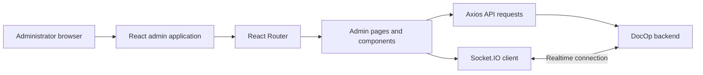

# DocOp Admin Frontend

The admin application is a separate React/Vite web client for DocOp administrative workflows. It communicates with the shared backend API and is deployed separately from the patient frontend.

## Responsibilities
- Render the administration interface.
- Navigate admin views with React Router.
- Make backend requests using Axios.
- Use Socket.IO client support for real-time features.
- Display UI notifications through React Toastify.

Authorization must be enforced by the backend. Hiding a page or button in the browser is not a security boundary.

## Architecture



## Technology
- React 19 and React DOM
- Vite 7 and React Router
- Axios and Socket.IO client
- Tailwind CSS 4 and Vite/PostCSS integrations
- React Icons and React Toastify

## Requirements
- Node.js 20 or later recommended to match CI
- npm
- A reachable backend configured for the target environment

## Local development

```bash
cd admin
npm ci
npm run dev
```

Vite prints the development URL. Root Docker Compose publishes the production container at `http://localhost:5174`.

### Build and lint

```bash
npm run build
npm run preview
npm run lint
```

## API URL and base path

The Docker build accepts `VITE_BACKEND_URL` and `VITE_BASE_PATH`. Root Compose uses `VITE_BACKEND_URL=http://localhost:8000` and `VITE_BASE_PATH=/`.

In Kubernetes, Traefik routes the app at `http://docop.localhost/admin`. The `strip-admin` middleware removes `/admin` before forwarding requests to the admin Service. The cloud overlay applies public host/routing settings.

When changing the path, verify Vite's base path, asset URLs, React Router configuration and Traefik middleware together. `VITE_*` values are public client-side configuration; never store secrets in them.

## Docker and Kubernetes

```bash
docker build -t docop-admin ./admin
docker compose up --build -d admin
```

Kubernetes resources are in `k8s/40-admin.yaml`. They define two replicas and a Service on port 80 with readiness and liveness probes against `/`.

## Related docs
- [Main README](../README.md)
- [Backend README](../backend/README.md)
- [Kubernetes guide](../K8S.md)
