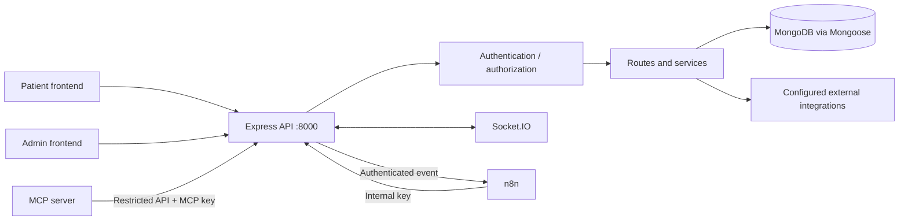

# DocOp Backend

The backend is the Node.js/Express API for DocOp. It owns application logic, authentication/authorization, MongoDB persistence through Mongoose, and the Socket.IO server used by the web applications. It also integrates with configured external services and communicates with n8n through authenticated webhook/internal API flows.

## Responsibilities
- Expose HTTP routes used by the patient and admin applications.
- Authenticate requests and enforce application authorization.
- Read and write application data through Mongoose and the configured MongoDB instance.
- Provide real-time communication through Socket.IO.
- Integrate with configured email, media-storage and payment providers.
- Send automation events to n8n and provide authenticated internal endpoints.
- Provide restricted API routes consumed by the separate MCP server.

n8n and the MCP server should call supported backend endpoints rather than connect directly to MongoDB.

## Architecture



Kubernetes probes use `GET /api/live` for startup/liveness and `GET /api/health` for readiness. Check the source before relying on other endpoint paths.

## Technology
- Node.js ES modules, Express 5 and Mongoose
- JSON Web Tokens and bcrypt
- Socket.IO, Redis client and Socket.IO Redis adapter dependencies
- Cloudinary, Brevo and Stripe SDKs
- Jest, Supertest and mongodb-memory-server

## Requirements
- Node.js 20 or later recommended to align with CI
- npm
- Reachable MongoDB and valid connection configuration
- Credentials for enabled external integrations
- n8n and shared authentication secrets when testing automation

## Local setup

```bash
cd backend
npm ci
npm start
```

For development with automatic restart:

```bash
npm run server
```

Create the environment file expected by the backend; check `.env.example` and source references for exact variable names. Never commit credentials. Kubernetes exposes container port `8000`; if you change it, update frontend URLs, Docker configuration, probes and Services together.

## Environment and secrets

Deployment references include:
- MongoDB connection and JWT/authentication settings
- Cloudinary, Brevo and Stripe credentials when those integrations are enabled
- `DOCOP_WEBHOOK_SECRET` for authenticated backend-to-n8n events
- `DOCOP_INTERNAL_KEY` for trusted internal API calls
- `DOCOP_MCP_KEY` for MCP server calls
- `CORS_ORIGINS`, `NODE_ENV` and `PORT`
- Redis connection settings when cross-instance Socket.IO messaging is enabled

Use Kubernetes Secrets for sensitive values and ConfigMaps for non-sensitive settings.

## Messaging and Socket.IO

The current backend documentation describes:
- Default maximum message length of 2,000 characters, configurable with `MAX_MESSAGE_LENGTH`.
- Empty messages rejected after trimming.
- Optional basic moderation via `BASIC_MODERATION_ENABLED`.
- Rate limiting configured by `SEND_RATE_MAX` and `SEND_RATE_WINDOW_MS`.
- Custom Socket.IO path `/socket.io/`; clients must use the same path.
- Documented user and doctor REST header conventions: `token` and `dtoken`.
- Cursor-based message history pagination using `before` and `limit`.

Check source code and tests for exact routes, payloads, acknowledgements and event behavior.

## Tests

```bash
npm test -- --ci
```

Some tests use `mongodb-memory-server`, which may download a MongoDB binary in a clean environment.

## Docker and Kubernetes

```bash
docker build -t docop-backend ./backend
kubectl apply -k k8s/
kubectl -n docop get deployments,pods,services
kubectl -n docop logs deploy/backend
```

Create required Secrets before applying Kubernetes resources. The backend manifest is `k8s/30-backend.yaml`; it defines two replicas, health probes, resource requests/limits and a non-root container security context.

## Related docs
- [Project overview](../README.md)
- [Kubernetes](../K8S.md)
- [Automation](../AUTOMATION.md)
- [MCP](../MCP.md)
- [Security hardening](../docs/PHASE0_SECURITY_HARDENING.md)
