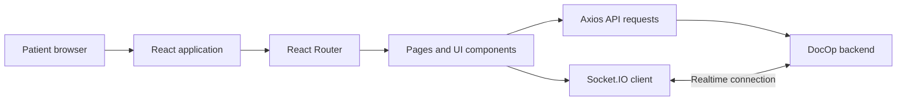

# DocOp Patient Frontend

The patient-facing DocOp web application is built with React and Vite. It communicates with the backend API over HTTP and uses Socket.IO client support for real-time features.

**Live Deployment (Azure):** [https://k8s.docop.me](https://k8s.docop.me)

## Responsibilities
- Render the patient-facing interface.
- Navigate screens with React Router.
- Send API requests using Axios.
- Connect to backend real-time features using `socket.io-client`.
- Render supported content and user notifications.

The backend remains responsible for authentication validation, business rules and persistence. Vite variables prefixed with `VITE_` are bundled into client-side code; never put private credentials in them.

## Architecture



## Technology
- React 19 and React DOM
- Vite 7 and React Router
- Axios and Socket.IO client
- Tailwind CSS
- React Markdown, React Hot Toast / React Toastify and React Icons

## Requirements
- Node.js 20 or later recommended to match CI
- npm
- A running backend or configured API URL

## Local development

```bash
cd frontend
npm ci
npm run dev
```

Vite prints the development URL. The default port is normally `5173`; Vite may choose another if it is occupied.

### Build and lint

```bash
npm run build
npm run preview
npm run lint
```

## API URL and base path

The Docker build accepts `VITE_BACKEND_URL` and `VITE_BASE_PATH`. Root Compose builds the patient frontend with `VITE_BACKEND_URL=http://localhost:8000` and `VITE_BASE_PATH=/`.

Kubernetes routes the frontend through Traefik at host `docop.localhost`, path `/`. If the API URL, host or base path changes, update Vite configuration, Docker build arguments, Ingress and CORS configuration together.

Do not put secrets in `VITE_*` variables.

## Docker and Kubernetes

```bash
docker build -t docop-frontend ./frontend
docker compose up --build -d frontend
```

Kubernetes resources are in `k8s/40-frontend.yaml`. They define two replicas and a Service on port 80 with readiness and liveness probes against `/`.

## Related docs
- [Main README](../README.md)
- [Backend README](../backend/README.md)
- [Kubernetes guide](../K8S.md)
